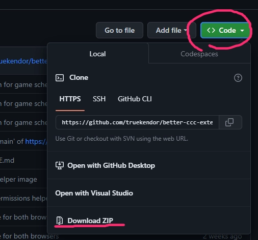
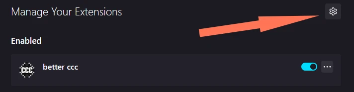
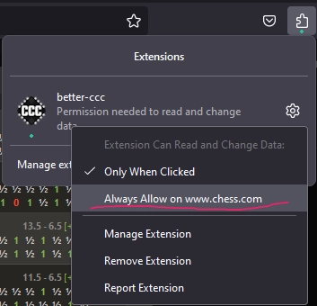
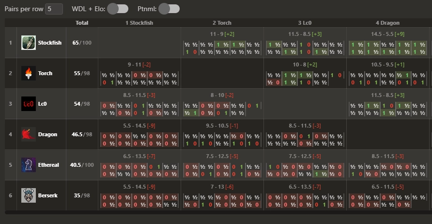
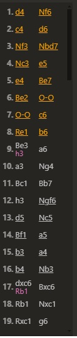
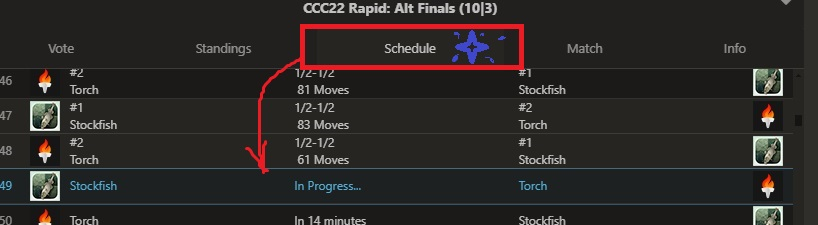

# Chrome/Firefox/Edge and android extension for [CCC](https://www.chess.com/computer-chess-championship#)

## Installation
- Download/clone this repo `(only needed for chrome)`
- 

## Firefox for *desktop*/*android*
- Make sure you have updated your browser
- Open [this link](https://addons.mozilla.org/en-US/firefox/addon/better-ccc/) in your browser and install the add-on

## Chrome / Edge / Other Chromium based browsers
- Unzip one of the archives from the chrome folder
- Open `chrome://extensions/` page
- Enable developer mode
- Click `Load unpacked` button
- Select the unziped `chrome` folder
- `!! Don't forget to uninstall the previous version of the extension`

## Other option for Firefox
- Open `about:addons` page
- Click on this button
- 
- Click `Install add-on From File...`
- Select `.xpi` file from `firefox` folder
- Grant permissions if needed
- 

## Features !TODO
  - Better cross table 
  - Reverse deviation highlight; Underline == same position
  - 
  - Click on schedule button to scroll to the current game 
  - GUI bugfixes
  - Extra hotkeys with a `?` help overlay listing every shortcut (can be turned off in the extension settings: `Extra hotkeys`)
  - Live tab title: the browser tab shows the last move (`34. Nf3`, `34… Rxe5`) or the result (`1-0`) of the displayed game, so you can follow it from another tab (setting: `Last move in tab title`)
 
## Hotkeys 

You can close `cross table`/`engine info` modals by pressing `Esc`

`Ctrl` + `Shift` + `U` to disable/enable shortcuts

Press `C` to open `Cross table`

Press `S` to open `Schedule`

Extra hotkeys (toggle `Extra hotkeys` in the extension settings):

Press `?` to show/hide the list of all hotkeys

Press `1`-`5` to switch the bottom panel tab (`Vote` / `Standings` / `Schedule` / `Match` / `Info`)

Press `L` to jump to the live game (opens the schedule if needed)

Press `E` to open/close the event list

Hotkeys are ignored while typing in an input field

# Acknowledgements

The idea and design are inspired by [David's](https://github.com/dav1312) custom extension

Formulas for calculating elo and error margins were taken from [here](https://3dkingdoms.com/chess/elo.htm)
